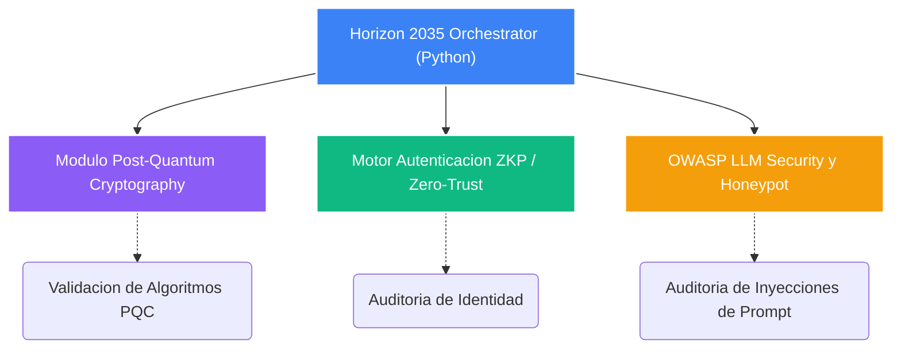

# Horizon 2035

[](https://csrc.nist.gov/projects/post-quantum-cryptography)
[](https://www.ncsc.gov.uk/collection/zero-trust-architecture)
[](https://owasp.org/www-project-top-10-for-large-language-model-applications/)
[](https://www.python.org/)

> **Orquestador automatizado disenado para la evaluacion y validacion de tecnologias emergentes criticas. Focalizado en ciberseguridad avanzada, permite la simulacion, despliegue y auditoria de Tecnologias Poscuanticas, Autenticacion Zero-Knowledge Proof (ZKP) en arquitecturas Zero-Trust, y el diseno de Honeypots para LLMs (Large Language Models) basados en los estandares de OWASP.**

---

## Executive Overview

El panorama de amenazas actual exige respuestas proactivas frente a saltos tecnologicos disruptivos como la computacion cuantica y los modelos de lenguaje a gran escala. **Horizon 2035** asegura que la infraestructura critica corporativa este preparada para mitigar riesgos sistemicos mediante validacion continua, garantizando un escudo resiliente en arquitecturas Zero-Trust.

---

## System Architecture (Mermaid)



---

## Estructura de Componentes

```text
horizont_2035/
├── .github/                # Flujos de CI/CD (Validacion continua)
├── Horizon2035_PROD.py     # Nucleo del orquestador (Produccion)
├── Horizon2035_DEMO.py     # Entorno de pruebas y simulacion
├── docker-compose.yml      # Entorno de contenedores para ejecucion aislada
├── Dockerfile              # Empaquetado del entorno de ejecucion
├── requirements.txt        # Dependencias de seguridad y criptografia
└── README.md               # Documentacion ejecutiva
```

---

## Capacidades Clave
1. **Auditoria Post-Quantum:** Preparacion y evaluacion de infraestructuras frente a amenazas de computacion cuantica.
2. **Defensa LLM:** Implementacion de contramedidas contra ataques a inteligencia artificial generativa, incluyendo *prompt injection* y exfiltracion de datos.